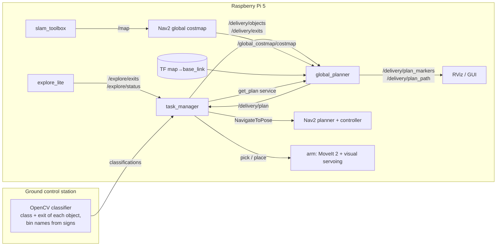
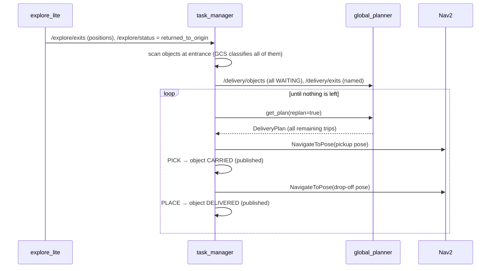

# Global planner: how it works

This guide explains the global path planning subsystem (`maze_planning` and
`maze_interfaces`): what it does, how it fits into the rest of the ROS 2 system,
which topics and messages it uses, how the algorithm works, and how to run and
test it.

## 1. What "global planning" means here

The mission is: explore the maze, then take every object waiting at the entrance
to the exit bin for its class (proposal 1.2, 2.3.2).

| | Global planning (this package) | Local planning (Nav2) |
|---|---|---|
| Question | **In what order** should the robot pick up and deliver the objects? | **Which route** does the robot drive to get to the next goal? |
| Input | Objects, their exits, the map, the robot's pose | One goal pose, the costmaps, the lidar |
| Output | An ordered list of steps: drive here, pick this, drive there, drop it | Velocity commands that follow a route |
| Runs | Before each trip (well under a second) | Continuously while driving |

The global planner decides *what to do next*. Nav2 (`NavigateToPose`) does the driving.

## 2. Where it sits in the system



* The **task manager** (proposal 2.2) owns the mission. It tells the planner
  what has to be delivered and where the exits are, asks it for a plan, and
  carries out the steps. The team's real `task_manager` is not written yet, so
  `mock_task_manager` stands in for it in simulation. It fakes the classifier
  and the arm, but it uses the same topics, service and Nav2 action the real
  one will.
* The **global planner** never drives the robot and never talks to the arm. It
  only answers "what is the fastest order from here?".

## 3. Topics, services and messages

### global_planner node

| Direction | Name | Type | What |
|---|---|---|---|
| sub | `/global_costmap/costmap` | `nav_msgs/OccupancyGrid` | Nav2's global costmap: walls, inflation, keepout zones |
| sub | `/delivery/objects` | `maze_interfaces/DeliveryObjectArray` | every object: id, class, exit, pose, state |
| sub | `/delivery/exits` | `maze_interfaces/ExitBinArray` | every exit found: id (bin name) + position |
| sub | `/tf` | `map → base_link` | where the robot is |
| pub | `/delivery/plan` | `maze_interfaces/DeliveryPlan` | the plan (latched) |
| pub | `/delivery/plan_path` | `nav_msgs/Path` | the whole route, for RViz / the GUI (FR-10) |
| pub | `/delivery/plan_markers` | `visualization_msgs/MarkerArray` | each trip's route in its own colour, numbered goals, objects, exits |
| srv | `/global_planner/get_plan` | `maze_interfaces/srv/GetDeliveryPlan` | `replan: true` plans now from the robot's current pose |

All `/delivery/*` topics are **latched** (durability `TRANSIENT_LOCAL`): a node
that starts later still receives the last message. This matters because
explore_lite exits when it is done, which takes its own latched exits with it,
so the task manager republishes them on `/delivery/exits`.

### Messages (`maze_interfaces`)

* **`DeliveryObject`** has `id`, `object_class`, `exit_id` and `pose`, plus a
  `state`: `WAITING` (at the entrance), `CARRIED` (in the gripper),
  `DELIVERED` or `FAILED`. The planner only plans `WAITING` and `CARRIED`
  objects. A `CARRIED` object is delivered first, with no pickup.
* **`ExitBin`** has an `id` (the bin's name, which `DeliveryObject.exit_id`
  refers to) and a `pose` (the middle of the exit opening).
* **`DeliveryPlan`** carries:
  * `status`: `OK`, `PARTIAL` (some objects left out, with reasons),
    `NOTHING_TO_DO` or `NO_PLAN`.
  * `steps[]` and the solver used (`exact` or `heuristic`).
  * Estimates: `total_time`, `total_distance`.
  * How long the planning computation took.
* **`PlanStep`** has an `action` (`NAVIGATE_TO_PICKUP`, `PICK`,
  `NAVIGATE_TO_EXIT` or `PLACE`), a `trip` number, `object_id`, `exit_id`, and
  `target` (the goal pose for Nav2). It also has estimates: `distance`,
  `duration`, and `start_time` (seconds after the plan starts).

Example plan (three-exit maze, six objects, capacity 1):

```
#  trip action              what          goal (x, y, yaw)        dist    time  starts
1  0    NAVIGATE_TO_PICKUP  obj_4         ( 0.28, -0.22,  -82)   0.00m    2.3s    0.0s
2  0    PICK                obj_4         ( 0.28, -0.22,  -82)   0.00m   20.0s    2.3s
3  0    NAVIGATE_TO_EXIT    exit_A        ( 1.88, -0.22,  119)   6.56m   67.2s   22.3s
4  0    PLACE               obj_4>exit_A  ( 1.88, -0.22,  119)   0.00m    8.0s   89.4s
5  1    NAVIGATE_TO_PICKUP  obj_6         ...
```

### Mission sequence



The task manager carries out **only the first trip** of each plan, then asks
again. Each new plan starts from where the robot really is and uses the latest
map, including any keepout zone added after a collision. Planning takes under
0.1 s, so replanning costs nothing noticeable.

## 4. How the planner works (`core/planner.py`)

### Step 1: what can the robot reach?
The costmap becomes a grid (`core/grid.py`). Unknown cells and cells within the
robot's radius of a wall (costmap ≥ 99, "inscribed") are blocked. Because
unknown space is blocked, routes can never leave the maze through an exit
(`allow_unknown = false`, proposal 2.3.2). One Dijkstra search from the robot
finds every reachable cell.

### Step 2: places
The robot can't drive *onto* an object or *into* an exit opening, so each one
gets an **approach pose**. That is a reachable free cell about `pickup_standoff`
(0.20 m) from the object or `exit_standoff` (0.25 m) from the exit. It must be
on the same side of every wall (straight line of sight) and must face the
target. This is the goal pose sent to Nav2.

### Step 3: how long is each drive? (`core/search.py`, `core/time_model.py`)
The planner needs the driving time between every pair of places. It runs
**Dijkstra once from each place** with the proposal's edge cost:

    c(u, v) = d(u, v) · (1 + μ · κ(v))

* `d` is the cell distance (r, or r√2 diagonally).
* κ is the costmap cost from 0 to 1. It is higher near walls.
* μ is `cost_travel_multiplier`, the same value Nav2's Smac planner uses.

One search gives the routes to *all* other places, so with 10 places that's 10
searches instead of 90 calls to Nav2. Each route is then straightened (string
pulling) and timed:

    time = length / cruise_speed + Σ over sharp turns (|angle| / rotate_speed + overhead)

Turns sharper than 45° are made in place, as Nav2's rotation shim controller
does. This turn cost is why the plan is *time*-optimal, not just shortest: a
route with many U-turns costs more than its length suggests.

Why Dijkstra and not A*? A* is faster for **one** goal, because its heuristic
aims at that goal. Here every search needs **several** goals at once, and
Dijkstra gives them all in one pass. Nav2 still uses A* (Smac) for the actual
driving.

### Step 4: the order (`core/solver.py`)
A **trip** means picking up at most `capacity` objects and then dropping them
at their exits. The mission is a sequence of trips, and it ends at the last
drop-off.

*Brute force* would try every order: 6 objects have 720 orders, 10 objects
have 3.6 million, 12 have 479 million. Instead the solver uses **dynamic
programming over subsets** (the Held–Karp algorithm, generalised to trips).
Once a set of objects is delivered, the rest of the mission depends only on
*which* objects are done and *where the robot is*, not on the order they were
done in. So for every state (delivered set, robot place) it keeps only the
cheapest way to get there:

    best[done ∪ T][end] = min over trips T, start place loc:
                          best[done][loc] + trip_time(loc → pick up T → drop T, ending at exit `end`)

The answer is the cheapest `best[all objects][any exit]`. This is **exactly
optimal**, the same answer brute force gives, at a fraction of the work:
12 objects take well under a second on a laptop. With more than
`max_exact_objects` (12), it switches to a heuristic (greedy plus improving
swaps) and labels the plan `heuristic`.

**What the optimum looks like with objects at the entrance and capacity 1.**
Every trip is entrance → exit → back to the entrance, except the **last**,
which doesn't come back. The sum of all the round trips is the same in any
order, so the only saving available is the last return drive. The optimal plan
therefore delivers to the **exit farthest from the entrance last**. In the
three-exit maze, exit C (about 84 s from the entrance) gets one of its objects
last. Small differences between pickup poses decide the rest. With capacity
2 or more, the solver also groups objects for the same exit, or nearby exits,
into one trip.

### Step 5: steps
The order becomes a list of NAVIGATE / PICK / NAVIGATE / PLACE steps, each with
its goal pose and estimated duration and start time.

## 5. Parameters (`config/global_planner.yaml`)

| Parameter | Default | Tune by |
|---|---|---|
| `capacity` | 1 | Objects carried at once. The code supports more. |
| `cruise_speed`, `rotate_speed`, `turn_overhead` | 0.12 m/s, 0.8 rad/s, 0.5 s | Compare the task manager's `estimated … took …` log lines on the real robot. |
| `pick_time`, `place_time` | 20 s, 8 s | Measure the arm. With objects at the entrance these don't change the order, only the estimates. |
| `pickup_standoff`, `exit_standoff` | 0.20 m, 0.25 m | Measure from the arm's reach once it arrives (proposal 2.3.4 pre-grasp distance). |
| `cost_travel_multiplier` | 2.0 | Keep it equal to Nav2's planner setting. |
| `holonomic` | false | Set true once Nav2 drives the mecanum base sideways (`max_vel_y > 0`). |

## 6. Running it

### Offline (no ROS, instant)
```bash
cd ~/ros2_ws/src/capstone/maze_planning
ros2 run maze_planning plan_offline --layout layouts/three_exits_3m.txt \
    --scenario config/scenarios/three_exits_3m.yaml --svg plan.svg   # open plan.svg in a browser
ros2 run maze_planning plan_offline --benchmark 20                   # proposal test 4.2.5
```

### Lightweight simulation (ROS, no Gazebo, about 2 minutes)
```bash
ros2 launch maze_planning sim_lightweight.launch.py                  # three-exit maze, RViz
ros2 launch maze_planning sim_lightweight.launch.py maze:=default_maze capacity:=2 speed_scale:=4.0
```
`fake_world` publishes the explored maze's `/map` and `/global_costmap/costmap`,
the robot's TF, explore_lite's "done" and exits, and serves `navigate_to_pose`
by moving a simple robot along a route. The real `global_planner` and
`mock_task_manager` run unchanged. RViz shows each trip's route in its own
colour, numbered goals, the objects (yellow) and the exits (green).

### Full Gazebo simulation
```bash
ros2 launch maze_planning sim_delivery.launch.py                     # three-exit maze
ros2 launch maze_planning sim_delivery.launch.py maze:=default_maze gui:=true
```
This runs `maze_sim`'s simulation (Gazebo, SLAM, Nav2, explore_lite) exactly as
`maze.launch.py explore:=true`, plus the planner and the mock task manager.
The robot first explores (several minutes). When explore_lite reports it is
back at the start, the delivery begins. The objects exist only in the scenario
file and RViz, not in Gazebo.

### Useful commands while it runs
```bash
ros2 topic echo /delivery/plan --once                  # the current plan
ros2 topic echo /delivery/mission_status               # what the task manager is doing
ros2 service call /global_planner/get_plan maze_interfaces/srv/GetDeliveryPlan "{replan: true}"
ros2 service call /mock_task_manager/start std_srvs/srv/Trigger   # if started with start_on:=service
```

### Tests
```bash
cd ~/ros2_ws/src/capstone/maze_planning && python3 -m pytest -q test
```
There are 93 tests. They cover the grid, the search, the time model, the
solver (checked against brute force for capacities 1 to 3), and whole plans on
the Gazebo maze and on 20 random mazes. The random-maze tests are proposal test
4.2.5: "time-optimal route in 100% of layouts".

## 7. Requirements covered

| Requirement | How |
|---|---|
| FR-5: route to target exits using A* | Order from the global planner. Nav2 (Smac A*) drives each leg. |
| FR-7, FR-9: right exit; continue until all are delivered | Plans every `WAITING`/`CARRIED` object to its `exit_id`, and replans until `NOTHING_TO_DO`. |
| FR-10: GUI shows the planned path | `/delivery/plan_path` and `/delivery/plan_markers` |
| NFR-4: full task within 30 min | `total_time` estimates it before starting (about 16 min for six objects in the 3 m maze). |
| 2.7 / 4.2.5: optimal route in 100% of random layouts | Exact solver, checked against brute force in the tests and in `--benchmark` |
| 2.7: later deliveries faster than the first | The task manager logs every trip time and the first-trip vs later-trips mean. |
| NFR-9: modular | Core has no ROS. Plain messages. Capacity, speeds and standoffs are parameters. |

## 8. Using it on the real robot

1. Launch `ros2 launch maze_planning global_planner.launch.py` next to Nav2.
2. The real task manager must:
   * publish `/delivery/objects` (latched) after the GCS classifies the objects,
     and again whenever an object's state changes;
   * publish `/delivery/exits` (latched), with positions from `/explore/exits`
     and names from the GCS bin-sign reading;
   * call `/global_planner/get_plan` with `replan: true` before each trip, then
     send the NAVIGATE goals to Nav2 and the PICK/PLACE steps to the arm.

   `mock_task_manager_node.py` is a working template for all of this.
3. Set `pick_time`, `place_time`, the standoffs and the speeds from measurements.

**Nav2 planner choice.** With `maze_navigation/config/nav2_maze.yaml` as it is
(NavFn, `use_astar: false`, `allow_unknown: true`), a check against a real
Nav2 `planner_server` got NavFn's "Failed to create a plan from potential"
error for 5 of the 12 delivery goals. With `SmacPlanner2D` (`allow_unknown:
false`, `cost_travel_multiplier: 2.0`), which proposal 2.3.2 specifies, all 12
goals were accepted, and its routes to the exits were within a few percent of
this planner's estimates. Switching the delivery phase to Smac 2D is
recommended.

## 9. Files

```
maze_interfaces/                    messages and service (ament_cmake / rosidl)
├── msg/DeliveryObject.msg, DeliveryObjectArray.msg
├── msg/ExitBin.msg, ExitBinArray.msg
├── msg/PlanStep.msg, DeliveryPlan.msg
└── srv/GetDeliveryPlan.srv

maze_planning/                      ament_python
├── maze_planning/
│   ├── core/                       no ROS imports: unit-testable anywhere
│   │   ├── grid.py                 costmap → grid, blocked cells, line of sight
│   │   ├── search.py               Dijkstra, path extraction, smoothing
│   │   ├── time_model.py           driving time of a route
│   │   ├── solver.py               delivery order (exact DP, heuristic, brute force)
│   │   ├── planner.py              the pipeline: places → legs → order → steps
│   │   └── maze_layout.py          ASCII mazes → costmaps; random mazes
│   ├── ros/
│   │   ├── global_planner_node.py  THE node (runs on the Pi)
│   │   ├── conversions.py          messages ↔ core classes, RViz markers
│   │   ├── mock_task_manager_node.py   simulation stand-in for task_manager
│   │   └── fake_world_node.py      lightweight simulator (maze, robot, Nav2 action)
│   └── tools/plan_offline.py       offline planning, SVG drawing, benchmark
├── config/global_planner.yaml      parameters
├── config/scenarios/*.yaml         objects, class → exit table, exit positions
├── layouts/*.txt                   maze drawings (make_maze.py format)
├── worlds/three_exits_3m.sdf       Gazebo world made from layouts/three_exits_3m.txt
├── launch/                         global_planner, sim_lightweight, sim_delivery
├── rviz/delivery.rviz              slam.rviz + costmap + plan markers
├── docs/global-planner-guide.md    this file
└── test/                           pytest
```

## 10. Questions you may be asked

* **Is the plan optimal?** Yes, for the time model and up to 12 objects. The
  solver is exact dynamic programming, and the tests and benchmark compare it
  with brute force on random mazes.
* **Why not ask Nav2 for every pair of places?** That's n² planner calls. One
  Dijkstra per place gives the same information, uses the same costmap and cost
  model, and needs no running Nav2. That's why it can be tested offline.
* **What if the map changes or a drive fails?** The task manager replans before
  every trip from the robot's actual pose and the current costmap. After a
  repeated failure it marks the objects `FAILED`, and the plan goes on without
  them (`PARTIAL`, with reasons).
* **What if an exit hasn't been found?** Its objects are left out with the
  reason "exit … has not been found". The task manager reports it for human
  assistance (proposal 2.3.1).
* **How does it scale?** About n²·2ⁿ for capacity 1: 6 objects take about
  0.08 s, including all the searches.
